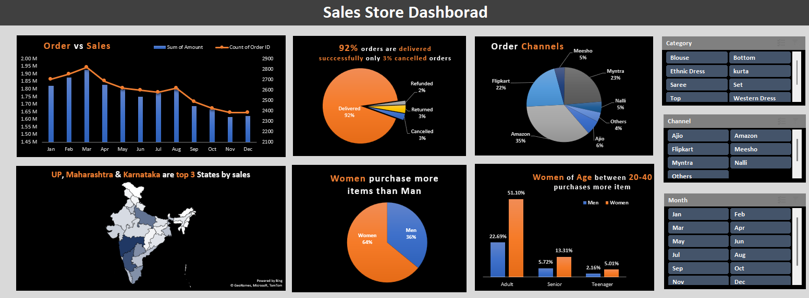

# 🛍️ Store Sales Analysis: Excel Dashboard

**An interactive Excel dashboard analysing ~31K online orders for a women's apparel store across marketplaces, states, age groups and order status.**

## What's inside

| File | Contents |
|---|---|
| [`Store Data Analysis.xlsx`](Store%20Data%20Analysis.xlsx) | Raw order data (~31K rows), 6 pivot-table analysis sheets and the dashboard |
| [`Sales Store Dashboard.pdf`](Sales%20Store%20Dashboard.pdf) | PDF export of the dashboard |

## Process

1. **Prepared** the data: added an **Age group** column (Teenager / Adult / Senior, from an `IF` formula on age) and a **Month** column from the order date.
2. **Analysed** with pivot tables: sales vs. orders by month, order status, sales channel, top states, and age × gender.
3. **Built** a one-page dashboard with slicers for **Category**, **Channel** and **Month**, so every chart filters together.

## Key insights

- **92%** of orders were delivered successfully; only **3%** were cancelled and 3% returned.
- **Amazon (35%)**, **Myntra (23%)** and **Flipkart (22%)** bring in 80% of orders.
- **Uttar Pradesh, Maharashtra and Karnataka** are the top three states by sales.
- **Women account for 64%** of purchases, and adult women are the largest buyer segment.
- Sales peaked in **March** and declined through the year-end.

## Recommendations

- Target adult women with offers on Amazon, Myntra and Flipkart, where most orders come from.
- Focus regional campaigns on the top three states.
- Investigate the second-half decline in orders before the next peak season.

Built on the publicly available "Vrinda Store" practice dataset.
